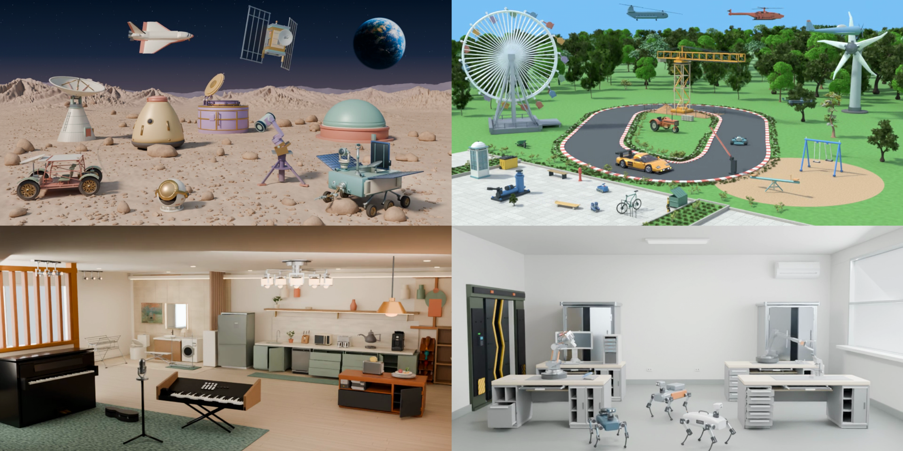

<div align="center">

# RFW-A: Agentic Procedural Generation of 400K Articulated Assets over 500 Categories

Yuanbo Lyu, Changjian Pan, Saining Zhang, Yi Yang, Peishuo Li, Zhiheng Li, Jialu Liu, Junhao Chen, Jiawei Weng, Yupeng Gao, Weiqing Xiao, Wenyi Li, Jiarui Guo, Rui Zhang, Jingrun Du, Weiyi Lin, Zenan Meng, Hu Wei, Lin Qu, Zongzheng Zhang, Hao Zhao, Chaojian Li

[](https://arxiv.org/abs/2610.40333)
[](https://github.com/RoboFlywheel-com/RoboFlywheel-Articulation)
[](https://modelscope.cn/datasets/RoboFlywheel/Articulation)

[Overview](#overview) · [Dataset](#dataset) · [Citation](#citation) · [Release Plan](#release-plan)



<sub><b>RFW-A-400K</b>: 402,410 procedurally generated articulated assets spanning more than 500 object categories.</sub>

</div>

---

## Overview

**From reusable construction logic to 400K simulation-ready articulated assets.** RoboFlywheel-Articulation (RFW-A) combines agentic synthesis with procedural generation. Starting from existing articulated programs, RFW-A organizes reusable components and their dependencies into category-level generators. Agents test and refine these generators across sampled configurations and motion states. Once constructed and validated, the generators produce diverse assets through procedural execution with no further model calls or token charges.

| Stage | What happens |
| --- | --- |
| **Agentic synthesis** | Agents construct reusable category-level generators from existing articulated programs, then test and refine them across sampled configurations and motion states |
| **Procedural generation** | Validated generators produce diverse articulated assets through procedural execution, requiring no further model inference |
| **Validation** | The paper evaluates sampled assets for structural and kinematic validity and cross-simulator compatibility in Genesis, PyBullet, MuJoCo, and Isaac Sim |

Using RFW-A, we build **RFW-A-400K**, containing **402,410 articulated assets across more than 500 object categories**. Each asset includes explicit part structure, kinematics, estimated physical properties, and reproducible generation parameters.

Training with RFW-A-400K improves part-level articulation estimation on seen and unseen categories. Across five manipulation tasks, policies trained in simulation with retrieved and program-edited assets transfer zero-shot to real articulated objects.

---

## Code and Quickstart

This repository includes the RFW-A generator-construction tools, procedural
sampling runtime, articulated-object SDK, mechanical checks, material binding,
and directed editing. Source asset generation and record management are integrated
from the shared Articraft runtime; its original import paths remain compatible.

The generator-construction pipeline is not tied to Articraft sources. Any
procedural CAD pipeline — code-authored parametric geometry with explicit part
structure and articulation — can supply source assets: an external agent or
human author imports them with `rfwa source
external` (see [EXTERNAL_AGENT_DATA.md](EXTERNAL_AGENT_DATA.md)), after which
source maps, blueprints and generators are built the same way.

Use Python 3.11 or 3.12 and [uv](https://docs.astral.sh/uv/). Clone this repository
and run the following from its root directory (Linux is the tested platform):

```bash
uv sync --locked --group dev
uv run rfwa generators
uv run rfwa config single_revolute_hinge --seed 0
uv run rfwa sample single_revolute_hinge --seeds 0-2 --out /tmp/rfwa-hinges
```

Sampling runs geometry, URDF and sampled-motion checks and writes each passing
seed's assets and a `sampling.json` construction record. It uses no model API.
The output directory must be empty. Bundled generators include legacy programs;
the inventory is not a claim that every generator meets the current release gate.

For new categories, use the source-map and blueprint tools, implement the generator,
then assess the generator before sampling at scale:

```bash
uv run rfwa author --help
uv run rfwa check <generator> --stage random-16
uv run rfwa check <generator> --stage random-36
uv run rfwa release <generator>
```

`check` and `release` default to a practical 90% sampled pass-rate threshold; default readiness checks use random-16 and random-36.
Passing assets are retained; failing seeds are logged and skipped. Missing legacy
blueprints or source records are reported without blocking useful generators.
Use `--pass-threshold` to adjust the target, or `--strict` to opt into all-cases-pass,
complete-coverage and provenance requirements. Four authoring roles are documented
for an external agent or human coordinator; this code does not provide an autonomous
four-agent scheduler.

This is the generator and local-tooling release. The paper reports cross-simulator
and downstream task results; the corresponding evaluation scripts, training
checkpoints and datasets are not included here. Local mechanical and sampled-motion
checks do not reproduce those experiments.

Material-grounded export accepts `--library-pointer /path/to/unified/latest.json`.
The 400K dataset, source-record collection and frozen PBR library are separate
artifacts and are not bundled in this code checkout. The six physical properties
are estimated annotations; material binding preserves authored URDF inertias.

- [Generator construction and role instructions](docs/generator_construction.md)
- [Sampling, material grounding and directed editing](docs/usage.md)
- [Paper-to-code mapping and migration decisions](docs/architecture.md)
- [Code provenance and compatibility](docs/migration.md)

---

## Paper

**RFW-A: Agentic Procedural Generation of 400K Articulated Assets over 500 Categories**<br>
Yuanbo Lyu, Changjian Pan, Saining Zhang, Yi Yang, Peishuo Li, Zhiheng Li, Jialu Liu, Junhao Chen, Jiawei Weng, Yupeng Gao, Weiqing Xiao, Wenyi Li, Jiarui Guo, Rui Zhang, Jingrun Du, Weiyi Lin, Zenan Meng, Hu Wei, Lin Qu, Zongzheng Zhang, Hao Zhao, Chaojian Li

arXiv preprint: [arXiv:2610.40333](https://arxiv.org/abs/2610.40333) (October 2026).

---

## Dataset

The full dataset is planned for release on **ModelScope** in **November 2026**. The official dataset link, inventory, directory structure, download instructions, and usage examples will be added here when available.

**ModelScope dataset:** [RoboFlywheel/Articulation](https://modelscope.cn/datasets/RoboFlywheel/Articulation) · **Release:** November 2026

---

## Citation

```bibtex
@misc{rfwa2026,
  title={RFW-A: Agentic Procedural Generation of 400K Articulated Assets over 500 Categories},
  author={Yuanbo Lyu and Changjian Pan and Saining Zhang and Yi Yang and Peishuo Li and Zhiheng Li and Jialu Liu and Junhao Chen and Jiawei Weng and Yupeng Gao and Weiqing Xiao and Wenyi Li and Jiarui Guo and Rui Zhang and Jingrun Du and Weiyi Lin and Zenan Meng and Hu Wei and Lin Qu and Zongzheng Zhang and Hao Zhao and Chaojian Li},
  year={2026},
  eprint={2610.40333},
  archivePrefix={arXiv},
  primaryClass={cs.CV},
  doi={10.48550/arXiv.2610.40333}
}
```

---

## License

Code is distributed under [Apache-2.0](LICENSE), with inherited notices retained in
[NOTICE](NOTICE) and third-party dependency licenses listed in
[THIRD_PARTY.md](THIRD_PARTY.md). Dataset and material-library terms will
accompany their releases; the Apache-2.0 grant here does not extend to them.

---

## Release Plan

- [x] Generator code and local tooling — October 2026
- [ ] Full dataset on ModelScope — November 2026
- [x] Paper on arXiv — [arXiv:2610.40333](https://arxiv.org/abs/2610.40333), October 2026

---

## Category scope of this release

The bundled generator inventory lists **507 registered generator templates** (see
`agent/template_registry.py` for the authoritative list). Categories whose primary
use is military, law-enforcement crowd control, surveillance, or weapon/unmanned
platforms are **not included** in this public release, and their implementations,
specs, source records and tests have been removed. The paper's dataset figures
(402,410 assets across more than 500 categories) describe the full research
dataset; the code release scope is defined by the registry in this repository.

从参考图构建新类别和 generator，参见 [图像到 generator 的完整流程](docs/image_to_generator.md)。
