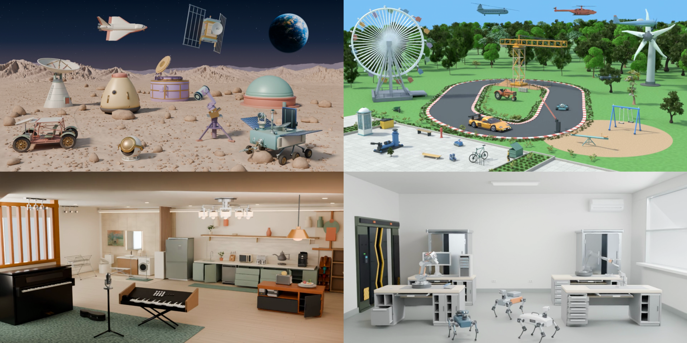

# RFW-A 开源代码

**RFW-A: Agentic Procedural Generation of 400K Articulated Assets over 500 Categories**

RFW-A（RoboFlywheel-Articulation）将智能体合成与程序化生成结合：智能体为每个类别一次性构建可复用的 category-level generator，之后由程序化执行批量产出可用于仿真的关节物体资产，不再消耗模型调用。

[English README](README.md) · [Generator 构建](docs/generator_construction.md) · [采样与编辑](docs/usage.md) · [论文-代码对应](docs/architecture.md) · [外部源数据](EXTERNAL_AGENT_DATA.md)



## 当前论文统计

论文数据集 **RFW-A-400K** 包含 **402,410 件关节资产、531 个类别**，每件资产带有显式的部件结构、运动学、估计物理属性和可复现的生成参数。论文在 Genesis、PyBullet、MuJoCo、Isaac Sim 上验证了结构/运动学有效性与跨仿真器兼容性；用 RFW-A-400K 训练可提升部件级关节估计，仿真中训练的策略可零样本迁移到真实关节物体。

本仓库包含 generator 构建工具、程序化采样运行时、关节物体 SDK、机械检查、材质绑定与定向编辑。论文对应的评测脚本、训练 checkpoint 与完整数据集不包含在本仓库中。

**轻量版数据集 RFW-A-Light 已在 ModelScope 发布**：[RoboFlywheel/Articulation](https://modelscope.cn/datasets/RoboFlywheel/Articulation)，10,000 件资产、531 个类别、Apache-2.0。每个资产目录含 `model.urdf`、`part_physics.json`（整体与逐部件物理属性）、`appearance.json`（PBR 材质绑定）、网格、纹理与 affordance 标注；数据集页面附 PyBullet / MuJoCo / Genesis / SAPIEN / Isaac Sim 的导入说明。

## 本地开始

在仓库根目录执行，需要 Python 3.11/3.12 和 [uv](https://docs.astral.sh/uv/)（Linux 为已测试平台）：

```bash
uv sync --locked --group dev
uv run rfwa generators
uv run rfwa config single_revolute_hinge --seed 0
uv run rfwa sample single_revolute_hinge --seeds 0-2 --out /tmp/rfwa-hinges
```

采样会运行几何、URDF 与采样运动检查，写出每个通过 seed 的资产和 `sampling.json` 构建记录，全程不调用模型 API。输出目录必须为空。

从参考图构建新类别和 generator 的完整流程，参见 [图像到 generator 的完整流程](docs/image_to_generator.md)。

## 许可

代码以 [Apache-2.0](LICENSE) 发布，继承声明见 [NOTICE](NOTICE)，第三方依赖许可见 [THIRD_PARTY.md](THIRD_PARTY.md)。Apache-2.0 授权仅覆盖本仓库原创代码，不延伸至第三方模型权重、仿真器运行时与单独分发的数据集；数据集与材质库的条款随其各自发布提供。

## 引用

```bibtex
@misc{rfwa2026,
  title={RFW-A: Agentic Procedural Generation of 400K Articulated Assets over 500 Categories},
  author={Yuanbo Lyu and Changjian Pan and Saining Zhang and Yi Yang and Peishuo Li and Zhiheng Li and Jialu Liu and Junhao Chen and Jiawei Weng and Yupeng Gao and Weiqing Xiao and Wenyi Li and Jiarui Guo and Rui Zhang and Jingrun Du and Weiyi Lin and Zenan Meng and Hu Wei and Lin Qu and Zongzheng Zhang and Hao Zhao and Chaojian Li},
  year={2026},
  eprint={2610.40333},
  archivePrefix={arXiv},
  primaryClass={cs.CV},
  doi={10.48550/arXiv.2610.40333}
}
```
